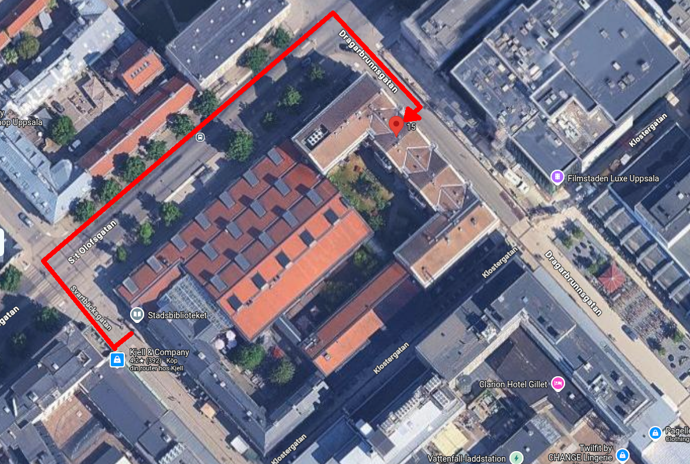

# Thank-you for the volunteers

- What: Thank-you for volunteers
- When: Saturday 12th December 2026
- Time: after the student presentations, around 13:00
- Goal: to thank all the volunteers that directly or indirectly helped
  the Saturday courses
- Who: everyone that has directly or indirectly helped the Saturday courses
- Costs: whatever you make it more than what we pay, see details below.

[Ölstugan Tullen Uppsala](https://olstugan.se/sv/restaurants/uppsala),
Dragarbrunnsgatan 15, 753 20 Uppsala, Uppsala,
[Map](https://maps.app.goo.gl/J7SiyyES2UEqJwFH6)

To thank all the volunteers that directly or indirectly helped
the Saturday courses, you are welcome to join us for a drink
at Ölstugan Tullen at Dragarbrunnsgatan 15, Uppsala.

The first drink will be on the Lördagskurserna,
your second, third, etc. will be on Richel.
You are welcome to drink and eat as much as you like.
Ad you are welcome to pay as much as you feel you should:
we have a tab :-)

